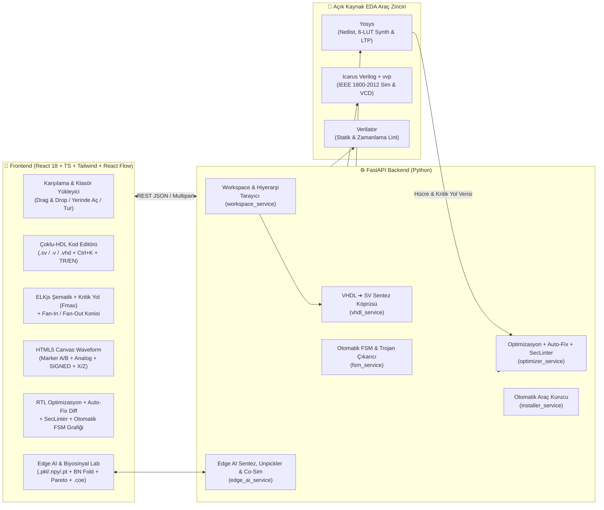

<div align="center">


# CircuitVR (V 2.16)

### **SystemVerilog · Verilog · VHDL RTL, Hardware Security & Edge AI Co-Design Studio**

*Gerçek Zamanlı Sentez Şematiği & Kritik Yol ($F_{\max}$), VCD/Analog Dalga Formu, Tek-Tık Auto-Fix & Donanım Güvenlik Denetçisi (SecLinter), Otomatik FSM Durum Diyagramı ve Python (`.pkl`/`.npy`/`.pt`) ➔ Sabit Noktalı ($Qm.n$) 1D-CNN Biyosinyal Donanım Sentezleyicisi*  
*Real-Time Synthesis Schematics & Critical Path ($F_{\max}$), VCD/Analog Waveform, One-Click Auto-Fix & Hardware Security Linter (SecLinter), Automatic FSM State Diagram & Python (`.pkl`/`.npy`/`.pt`) ➔ Fixed-Point ($Qm.n$) 1D-CNN Biosignal Hardware Studio*

[](#)
[](#)
[](#)
[](#)
[](#)
[](#)

[**🇹🇷 Türkçe Dokümantasyon**](#-türkçe-dokümantasyon) • [**🇬🇧 English Documentation**](#-english-documentation) • [**⚡ Tek Tık Kurulum**](#-1-hızlı-ve-tam-otomatik-kurulum-sıfır-ayar) • [**🧬 Edge AI Lab**](#-f-edge-ai--biyosinyal-1d-cnn--dsp-donanım-ortak-tasarım-stüdyosu-edge-ai-lab)

</div>

---

# 🇹🇷 Türkçe Dokümantasyon

## 🎯 Proje Neden Geliştirildi?

**CircuitVR**, donanım, FPGA ve Edge AI mühendislerinin devasa boyutlu (50+ GB) kurumsal FPGA/ASIC araçlarını açmadan; **SystemVerilog (`.sv`, `.svh`)**, **Verilog (`.v`, `.vh`)** ve **VHDL (`.vhd`, `.vhdl`)** projelerini saniyeler içinde:
1. **Kodlayabildiği** (canlı hata/uyarı işaretlemeli Monaco editörü, otomatik SHA-1 dosya izleyicisi, **`Ctrl+K` Global Komut Paleti** ve **İnteraktif Tanıtım Turu**),
2. **Sentezleyip Kapı Seviyesi Şematiğini, Kritik Yolu ve Tahmini $F_{\max}$ Değerini İnceleyebildiği** (Yosys + ELKjs ortogonal yerleştirme + **Kırmızı Kritik Yol Vurgulama** + **Fan-In / Fan-Out Etki Konisi**),
3. **Testbench ile Simüle Edip VCD + Analog Dalga Formunu Analiz Edebildiği** (Icarus Verilog + **İkili İmleç `Marker A / B` ($\Delta t$, $\text{MHz}$)**, **Analog Biyosinyal Çizimi**, **SIGNED 2'ye Tümleyen Radix**, **Saat Frekansı/Duty-Cycle Ölçümü** ve **`X/Z` Belirsiz Durum Kök-Neden Tablosu**),
4. **Tek Tıkla RTL Auto-Fix, Diff Önizleme ve Donanım Güvenlik Denetiminden (`SecLinter`) Geçirebildiği** (`0–100` Optimizasyon Skoru + **Diff Önizleme Modalı** + **10 Kademeli Geri Al (`Undo`)** + **`// circuitvr-ignore`** + **CDC / Kombinasyonel Döngü / Nadir Tetiklenen Trojan Denetimi**),
5. **Otomatik FSM Durum Diyagramı Çıkarabildiği** (SV/Verilog/VHDL durum makinelerini, geçiş koşullarını ve ulaşılamayan **Ölü / Trojan Durumları** interaktif SVG diyagram olarak çizen `fsm_service.py`),
6. **Edge AI & Biyosinyal (1D-CNN / DSP) Donanım Ortak-Tasarım Stüdyosu (`Edge AI Lab`)** ile Python'da üretilen **`.pkl` / `.pickle` (Güvenli Kısıtlı Unpickler), `.npy`, `.npz`, PyTorch `.pt` / `.pth`, `.json`, `.csv`, `.coe`, `.mem`** modellerini doğrudan içeri aktarıp; **PyTorch `BatchNorm1d` Katlama (`Fold into Conv1D`)**, **RNE (Round-Half-to-Even) Niceleme**, **Doyma (`Saturate`) vs. Taşma (`Wrap`)** karşılaştırması, **Pareto (`SQNR dB vs. LUT`) Grafiği**, **3 Farklı Donanım Mimarisi (`Parallel MAC`, `BRAM ROM .mem/.coe`, `Folded Time-Multiplexed MAC`)** ve **64 örneklik bit-doğru (bit-exact) ECG/EEG Golden Testbench + RTL hızlandırıcısını** tek tıkla üretebildiği

modern, karanlık temalı (Dark Mode & Glassmorphism) ve **Dual-Runtime (Yerel Tam EDA + Vercel Serverless Bulut)** destekli bir donanım IDEsidir.

---

## 🏗️ Sistem Mimarisi (Architecture)



---

## ⚡ 1. Hızlı ve Tam Otomatik Kurulum (Sıfır Ayar)

GitHub'dan projeyi indiren bir kullanıcının bilgisayarında **Yosys**, **Icarus Verilog** veya **Verilator** kurulu olmasa bile; proje içindeki **Otomatik Araç Kurucu (`setup.bat` / `setup.sh` / `setup_tools.py`)** tüm bağımlılıkları ve taşınabilir (portable) EDA derleyicilerini `~/.circuitvr/tools/` dizinine **yönetici izni veya manuel `PATH` ayarı gerektirmeden** otomatik kurar.

### 🪟 Windows (Tek Tıkla Kurulum ve Başlatma)

```powershell
git clone https://github.com/YigitEXP/CircuitVR.git
cd CircuitVR
setup.bat
```

> **İpucu:** İlk kurulumdan sonra uygulamayı istediğiniz zaman **`run_local.bat`** dosyasına çift tıklayarak başlatabilirsiniz.

### 🐧 Linux & 🍎 macOS

```bash
git clone https://github.com/YigitEXP/CircuitVR.git
cd CircuitVR
chmod +x setup.sh auto.sh
./setup.sh
```

### 🐳 Docker ile Çalıştırma (Opsiyonel)

```bash
docker-compose up --build -d
```

---

## 🔍 2. Temel Modüller ve Tüm İşlevler (V 2.16 Envanteri)

### 📂 A) Esnek Proje & Dosya Yönetimi (`rtl/` + `tb/`) + İnteraktif Tur & Komut Paleti
* **Sürükle-Bırak (Drag & Drop) ve Klasör Yükleme:** Proje klasörünüzü veya tekil `.sv`, `.v`, `.vhd`, `.vhdl` dosyalarınızı doğrudan karşılama ekranına sürükleyip bırakabilirsiniz. Dosyalar otomatik olarak `rtl/` (tasarım) ve `tb/` (testbench) gruplarına ayrılır.
* **Yerinde Klasör Açma (In-Place Workspace):** Bilgisayarınızdaki mevcut bir klasörü kopyalamadan doğrudan yerinde açar. Harici bir editörde (ör. VS Code veya Vivado) dosyayı değiştirdiğinizde **SHA-1 parmak izi izleyicisi** değişikliği 2 saniye içinde algılar ve projeyi canlı günceller.
* **Otomatik Hiyerarşi ve Top Modül Tespiti:** Modül ve VHDL `entity`/`architecture` örneklemelerini (`port map` dahil) tarayarak en üst tasarım modülünü (`Top`) ve testbench modülünü (`TB`) otomatik seçer.
* **`Ctrl + K` Global Komut Paleti (`CommandPalette`):** Klavyeden `Ctrl+K` (veya `Cmd+K`) ile tüm aksiyonlara (Simülasyon, Şematik, Lint, Analiz, Edge AI Lab, Dil Değiştirme) ve proje dosyalarına anında bulanık arama (fuzzy search) ile erişim sağlar.
* **7 Adımlı İnteraktif Tanıtım Turu (`OnboardingTour`):** Siteye ilk kez giren kullanıcılara arayüzdeki tüm işlevleri adım adım tanıtır; *"Bir daha gösterme"* seçeneği ve üst bardaki **Tanıtım Modu (`?`)** butonu ile her zaman yeniden başlatılabilir.

### 📐 B) Gerçek Yosys Sentez Şematiği, Kritik Yol ($F_{\max}$) & Fan-In/Fan-Out Konisi (`SchematicViewer`)
* Tasarımınızı Yosys ile gerçek bir kapı/hücre netlist'ine dönüştürür ve **ELKjs** ortogonal yönlendirme algoritmasıyla çizer.
* **DAG Kritik Yol (Critical Path) ve Tahmini $F_{\max}$ Analizi:** Şematik grafiği üzerinde ardışıl elemanlar (`$dff`) arasındaki en uzun kombinasyonel mantık derinliğini (`logic_depth`) hesaplar, **tahmini maksimum saat frekansını ($F_{\max}$ MHz)** ve darboğaz yolunu (ör. `in ➔ $add ➔ $mux ➔ out`) üst barda gösterir. **🔥 Kritik Yol** butonuyla en yavaş sinyal yolundaki düğüm ve kablolar kırmızı parıltıyla vurgulanır.
* **Fan-In (Sürücü) / Fan-Out (Alıcı) Etki Konisi:** Şematikte herhangi bir kapıya veya flip-flop'a tıkladığınızda o hücreyi süren tüm kaynakları (**Fan-In**) ve o hücrenin sürdüğü tüm hedefleri (**Fan-Out**) izole ederek geri kalan devreyi karartır.
* **Renk Kodlu Donanım Hücreleri & Flatten Seçeneği:** Giriş/çıkış portları (`port_in`/`port_out`), çoklayıcılar (`$mux`/`$pmux`), Flip-Flop'lar (`$dff`/`$adff`/`$sdff`), aritmetik kapılar (`$add`/`$sub`/`$and`/`$xor`) ve alt modülleri renk kodlu gösterir; tek tuşla hiyerarşiyi kapı seviyesinde düzleştirir (`Flatten`).

### 📈 C) Tek Tık Simülasyon, İkili İmleç ($\Delta t$), Analog Mod & `X/Z` Kök-Neden Analizi (`WaveformViewer`)
* Testbench dosyanızda `$dumpfile` veya `$dumpvars` yazmayı unutmuş olsanız bile CircuitVR arka planda otomatik bir VCD yakalayıcı (`__cvr_dump.sv`) enjekte eder ve sonsuz döngüleri önlemek için ayarlanabilir maksimum simülasyon süresi (`Maks ns`) uygular.
* **İkili Zaman İmleci (`Marker A` & `Marker B`):** Sol tık ile `Marker A` (Sarı), `Shift + Sol Tık` ile `Marker B` (Camgöbeği) yerleştirerek iki olay arasındaki **$\Delta t$ (ns) zaman farkını** ve **karşılık gelen frekansı ($\text{MHz}$)** canlı ölçer.
* **SIGNED (2'ye Tümleyen) Radix & Analog Dalga Çizimi:** Sabit noktalı ($Qm.n$) DSP ve Edge AI filtre çıkışlarını **SIGNED (İşaretli Tam Sayı)** tabanında okur ve **Analog Mod** açıldığında çok-bitli veri yollarını sürekli analog biyosinyal eğrisi olarak çizer.
* **Otomatik Saat (Clock) Ölçümü & `X/Z` Belirsiz Durum Kök-Neden Tablosu:** Seçili sinyalin kenar geçiş sayısını, ortalama periyodunu, frekansını ($\text{MHz}$) ve doluluk oranını (`Duty Cycle %`) hesaplar; simülasyonda tanımsız (`x`) veya yüksek empedans (`z`) oluşan ilk zaman damgasını (`ns`) tespit edip tek tıkla imleci o hataya odaklar.

### 🛡️ D) Çift Katmanlı Lint ve Yapısal Ön-Denetim (`Verilator` + `AST`)
* Derleyiciye gitmeden önce kendi yapısal analizcimiz eksik `endmodule` / `end entity` hatalarını ve projede bulunmayan alt modül çağrılarını (`MODNOTFOUND`) Türkçe/İngilizce açıklamalarla yakalar.
* Ardından **Verilator** (veya yedek olarak **Icarus Verilog**) ile tam IEEE 1800-2012 lint denetimi çalıştırır.
* Alt paneldeki veya Analiz sekmesindeki herhangi bir hataya tıkladığınızda editör doğrudan ilgili dosya ve satıra (`file:line`) odaklanır.

### 🧠 E) Akıllı RTL Optimizasyon Danışmanı, Tek-Tık Auto-Fix & Donanım Güvenlik Denetçisi (`SecLinter` + `FSM`)
Analiz sekmesinde kodunuzu hem **Statik AST Örüntü Analizi** hem de **Yosys Sentez Netlist (`stat` + `ltp`)** çıktılarıyla inceleyerek `0–100` arasında bir **Optimizasyon Skoru** verir:
* **Tek Tıkla Otomatik Düzelt (`Auto-Fix`) + Diff Önizleme + Geri Al (`Undo`) + Kural Bastırma (`Ignore`):**
  * **Diff Önizle & Uygula:** Kodu değiştirmeden önce yan yana kırmızı/yeşil satır farklarını (`Diff Preview Modal`) gösterir.
  * **Geri Al (`Undo`):** Bellekte 10 kademeli anlık görüntü (snapshot) tutarak yapılan otomatik düzeltmeleri tek tıkla geri alır.
  * **Bu Kuralı Bastır (`// circuitvr-ignore <RULE_ID>`):** Bilinçli tasarım tercihlerini (ör. bilerek kullanılan latch) tek tıkla yorum satırı direktifiyle susturur.
* **Otomatik FSM Çıkarımı ve İnteraktif Durum Diyagramı (`fsm_service.py`):** SystemVerilog, Verilog ve VHDL dosyalarındaki sonlu durum makinelerini (`enum`, `localparam`, `type state_type is (...)`), geçiş koşullarını ve başlangıç (`reset`) durumunu otomatik çıkarıp **SVG Durum Diyagramı** olarak çizer; ulaşılamayan (**Dead / Trojan State**) durumları kırmızı güvenlik uyarısıyla işaretler.
* **Donanım Güvenliği (`SecLinter`) ve CDC Kontrolleri:**

| Kural Kodu | Kategori | Tespit Edilen Anti-Pattern / Güvenlik Riski | Otomatik / Önerilen Donanım Çözümü |
| :--- | :--- | :--- | :--- |
| **`OPT-CASE-UNIQUE`** | **Alan (LUT) & Hız** | `case (state)` kullanımı (Öncelik Zinciri / Priority Tree üretir) | Paralel MUX sentezi için `unique case (state)` (**Auto-Fix**) |
| **`OPT-FSM-ENC`** | **FSM Kodlama** | Genişliği belirtilmemiş `typedef enum` (32-bit FF israfı!) | `typedef enum logic [N:0]` veya One-Hot kodlama (**Auto-Fix**) |
| **`OPT-ALWAYS-LEGACY`** | **Güvenilirlik** | Saatli blokta bloklayan atama (`=`) veya klasik `always @(...)` | `<=` (non-blocking) atama ve `always_ff` / `always_comb` (**Auto-Fix**) |
| **`OPT-LATCH-IF` / `CASE`** | **Latch Koruması** | `if`/`case` bloğunda eksik `else`/`default` veya `$dlatch` hücresi | Tam kapsamlı `default` / `else` dalı (**Auto-Fix**) |
| **`OPT-MUL-POW2`** | **Sıfır Kapı Aritmetiği** | 2'nin kuvvetleriyle çarpma/bölme (`x * 4`, `x / 8`) ve boyutsuz sabitler | Kablo kaydırma (`x << 2`, `x >> 3`) ve `+ 1'b1` (**Auto-Fix**) |
| **`OPT-CDC-UNSYNC`** | **CDC Güvenilirliği** | Farklı saat etki alanları (`clk_a` ➔ `clk_b`) arasında senkronizörsüz sinyal geçişi | 2-kademeli (`2-FF`) senkronizör zinciri (`sync_ff1`, `sync_ff2`) |
| **`OPT-SEC-COMBLOOP`** | **SecLinter (Güvenlik)** | Kombinasyonel blok (`always_comb` / `assign`) içinde sinyalin kendi kendini sürmesi (RO PUF / Osilasyon / DoS riski) | Geri beslemeyi saatli `always_ff` flip-flop üzerinden geçirme |
| **`OPT-SEC-TRIGGER`** | **SecLinter (Trojan)** | `32'hdeadbeef` gibi nadir sihirli sabitlerle yapılan şüpheli karşılaştırmalar | Yalnızca doğrulanmış kontrol durumlarının kullanılması |
| **`OPT-VHDL-STD`** | **VHDL IEEE Standartları** | Standart dışı `std_logic_unsigned`, `clk'event`, sınırsız `integer` | `ieee.numeric_std.all`, `rising_edge(clk)` (**Auto-Fix**) |

### 🧬 F) Edge AI & Biyosinyal (1D-CNN / DSP) Donanım Ortak-Tasarım Stüdyosu (`Edge AI Lab`)
Python'da (`PyTorch` / `NumPy` / `Scikit-Learn`) eğitilen 1D-CNN veya sayısal filtre modellerini doğrudan FPGA RTL donanımına taşırken uçtan uca bir tasarım akışı sunar:
* **Doğrudan Python Model İçe Aktarma (`.pkl`, `.npy`, `.npz`, `.pt`, `.json`, `.csv`, `.coe`, `.mem`):**
  * Güvenlik odaklı **`_RestrictedModelUnpickler`** ile rastgele kod çalıştırma (`RCE`) riski olmadan Python `pickle` (`.pkl`), NumPy (`.npy`/`.npz`) ve PyTorch `state_dict` (`.pt`/`.pth`) dosyalarından `weights`, `bias`, `bn_gamma`, `bn_beta`, `bn_mean`, `bn_var` ve test sinyallerini otomatik ayıklar.
  * Ayrıca PyTorch/Sklearn modellerini tek komutla dışa aktaran hazır **`export_to_circuitvr.py`** yardımcı betiğini tek tıkla indirmenizi sağlar.
* **PyTorch / Keras `BatchNorm1d` Katlama Motoru (`Fold into Conv1D`):**
  * Donanımda ekstra çarpıcı/bölen harcamamak için BatchNorm katmanını ağırlık ve bias içine matematiksel olarak katlar:
    $$w_{\text{folded}} = w \cdot \frac{\gamma}{\sqrt{\sigma^2 + \epsilon}}, \qquad b_{\text{folded}} = (b - \mu)\cdot \frac{\gamma}{\sqrt{\sigma^2 + \epsilon}} + \beta$$
* **Gelişmiş Sabit Nokta ($Qm.n$) Niceleme, `RNE` & Taşma (`Saturate` vs `Wrap`) Analizi:**
  * **3 Yuvarlama Modu:** `Round-to-Nearest`, **`RNE` (Convergent / Round-Half-to-Even — DSP/FPGA altın standardı)** ve `Truncate`.
  * **2 Taşma (Overflow) Modu:** **Doyma (`Saturate` — Sınırda Kırpma)** ve **2'ye Tümleyen Sarmalama (`Wrap-Around`)** davranışlarını simüle eder; sarmalama kaynaklı faz terslenmelerini ve kaç örneğin doyuma ulaştığını (`saturation_count`) raporlar.
* **İnteraktif Pareto (`SQNR dB vs. LUT`) Dağılım Grafiği ve Auto-Tune:** 7 farklı $Qm.n$ bit genişliği adayını (`Q1.5` ➔ `Q4.12`) tarayarak doğruluk (`SQNR dB`) ve donanım maliyeti (`Tahmini LUT`) eğrisini SVG grafik olarak çizer; hedef SQNR değerini sağlayan en düşük maliyetli Pareto-optimal noktayı önerir.
* **3 Sentezlenebilir RTL Mimari Modu ve `.mem` / `.coe` Bellek Çıktıları:**
  1. **`Parallel Pipelined MAC Tree`:** Her saat darbesinde 1 çıktı (`II=1`) üreten tam paralel mimari.
  2. **`BRAM / LUTROM Tabanlı (`$readmemh`)`:** Ağırlıkları `.mem` veya Xilinx Vivado Block Memory Generator `.coe` dosyalarından okuyan ROM mimarisi (**`weights_qmn.mem`** ve **`weights_qmn.coe`** tek tıkla indirilebilir).
  3. **`Folded Time-Multiplexed Tek-MAC FSM`:** Çok kanallı biyosinyallerde (ör. 32 kanal EEG) yalnızca **1 adet DSP48/Çarpıcı** kullanarak $K$ saat darbesinde konvolüsyonu tamamlayan ultra düşük alanlı FSM mimarisi.
* **İki Çalışma Modu:** İster hazır ECG/EEG/FIR şablonlarıyla sıfırdan RTL + TB sentezleyin (`Mod 1`), ister projenizdeki mevcut `.sv/.v/.vhd` dosyanızı algılatıp kendi RTL dosyanıza dokunmadan yalnızca ona özel **Bit-Exact Golden Testbench** üretin (`Mod 2`).

---

## ⌨️ 3. Klavye Kısayolları

| Kısayol | İşlev |
| :--- | :--- |
| **`Ctrl + K` / `Cmd + K`** | Global Komut Paletini açar (Tüm komutlar ve proje dosyalarında hızlı arama) |
| **`Ctrl + S`** | Açık olan `.sv` / `.v` / `.vhd` dosyasını kaydeder (Oto-lint açıksa anında lint çalıştırır) |
| **`F5`** | Seçili Testbench (`TB`) ile simülasyonu başlatır ve Waveform sekmesini açar |
| **`F6`** | Seçili Top modül (`Top`) için Yosys şematiğini ve Kritik Yol ($F_{\max}$) analizini üretir |
| **`F7`** | Tüm çalışma alanı üzerinde Lint denetimini çalıştırır |

---

## 📁 4. Proje Dizin Yapısı

```text
circuit_vr/
├── api/
│   └── index.py                      # Vercel Python/FastAPI Serverless giriş noktası
├── backend/
│   ├── app/
│   │   ├── api/
│   │   │   └── workspace.py          # REST API uç noktaları (/open, /schematic, /simulate, /lint, /synth-stats, /optimize, /fsm, /edge-ai/*)
│   │   ├── services/
│   │   │   ├── workspace_service.py  # Çoklu-HDL (.sv/.v/.vhd) proje tarayıcı ve hiyerarşi çıkarıcı
│   │   │   ├── yosys_service.py      # Yosys JSON netlist üretici
│   │   │   ├── schematic_service.py  # Yosys netlist ➔ Pin-doğru grafik + DAG Kritik Yol & Tahmini Fmax hesaplayıcı
│   │   │   ├── eda_service.py        # Icarus Verilog, Verilator ve Yosys synth/ltp yöneticisi
│   │   │   ├── vhdl_service.py       # VHDL analizcisi ve sentezlenebilir VHDL ➔ SV köprüsü
│   │   │   ├── optimizer_service.py  # Akıllı RTL Optimizasyon Danışmanı, Auto-Fix, Ignore & SecLinter
│   │   │   ├── fsm_service.py        # SV/Verilog/VHDL Otomatik FSM Çıkarıcı & Dead/Trojan State Dedektörü
│   │   │   ├── edge_ai_service.py    # Edge AI Qm.n Niceleyici, Güvenli Unpickler, BN Katlama, 3 Mimari RTL & Golden TB
│   │   │   ├── installer_service.py  # Çapraz platform otomatik EDA araç kurucusu
│   │   │   └── vcd_parser.py         # Değer değişim (VCD) dalga formu ayrıştırıcısı
│   │   └── main.py                   # FastAPI uygulama girişi ve SPA statik dosya sunucusu
│   ├── tests/
│   │   └── test_v215.py              # Auto-Fix, Ignore, FSM çıkarımı, Kritik Yol Fmax ve Edge AI Golden birim testleri
│   ├── setup_tools.py                # CLI otomatik EDA araç zinciri kurulum betiği
│   └── requirements.txt              # Yerel Python + Yosys bağımlılıkları
├── frontend/
│   ├── public/
│   │   └── favicon.svg               # Özel tasarım silikon çip / devre sekme ikonu
│   ├── src/
│   │   ├── components/               # TopBar, WelcomeScreen, Explorer, CodeEditor, SchematicViewer, WaveformViewer, AnalysisView, EdgeAiView, CommandPalette, OnboardingTour, DeveloperModal
│   │   ├── services/
│   │   │   ├── api.ts                # Backend istemcisi + Bulut yedekleme yönlendiricisi
│   │   │   └── cloudFallback.ts      # Vercel / Tarayıcı içi tam özellikli yedek analiz ve sentez motoru
│   │   ├── i18n.tsx                  # Türkçe (TR) & İngilizce (EN) anlık dil sistemi
│   │   └── version.ts                # Canlı arayüz doğrulama sürüm rozeti (V 2.16)
│   └── index.html
├── examples/
│   ├── counter_demo/                 # SystemVerilog hiyerarşik sayaç + top_demo örneği
│   └── vhdl_alu_demo/                # VHDL 8-bit ALU + Testbench örneği
├── setup.bat / setup.sh              # Tek tıkla tam otomatik kurulum sihirbazı
├── run_local.bat                     # Hızlı yerel başlatıcı (Windows)
└── vercel.json                       # Vercel dağıtım yapılandırması
```

---

# 🇬🇧 English Documentation

## 🌟 Overview

**CircuitVR (V 2.16)** is a dark-mode hardware design, hardware security & Edge AI co-design studio for **SystemVerilog (`.sv`)**, **Verilog (`.v`)**, and **VHDL (`.vhd`)** engineers. It combines:
* **Real Yosys Gate-Level Schematics** with orthogonal **ELKjs** layout, **DAG Critical Path & Estimated $F_{\max}$** highlighting, and interactive **Fan-In / Fan-Out Cone** tracing,
* **One-Click Simulation & HTML5 Canvas VCD Waveform Viewer** powered by **Icarus Verilog (`iverilog` + `vvp`)** with **Dual Cursors (`Marker A & B`, $\Delta t$, MHz)**, **Analog Biosignal Mode**, **SIGNED Two's Complement Radix**, and an **`X/Z` Unknown Root-Cause Inspector**,
* **Smart RTL Optimization Advisor & Hardware Security Linter (`SecLinter`)** with **One-Click Auto-Fix**, **Side-by-Side Diff Preview Modal**, **10-Step Undo**, **`// circuitvr-ignore` directives**, **CDC checks**, and **Automatic Interactive SVG FSM State Diagrams** with Dead/Trojan state detection,
* **Edge AI & Biosignal (1D-CNN / DSP) Co-Design Studio (`Edge AI Lab`)** that directly imports Python **`.pkl`, `.npy`, `.npz`, PyTorch `.pt`, `.json`, `.csv`, `.coe`, `.mem`** models via a safe restricted unpickler, folds **PyTorch `BatchNorm1d`** layers into Conv1D weights, compares **RNE rounding** & **Saturation vs. Wrap-Around** overflow, plots the **Pareto (`SQNR dB vs. LUT`) frontier**, exports **`.mem` / Xilinx `.coe`** files, and synthesizes **3 selectable hardware architectures** + **64-sample Bit-Exact Golden ECG/EEG Testbenches**,
* **Global Command Palette (`Ctrl+K`)**, **Interactive Onboarding Tour**, and **Instant TR / EN Language Toggle**.

## ⚡ Quick Start (Zero Manual Setup)

Cloning from GitHub automatically provisions Python packages, Node modules, and missing EDA binaries (`yosys`, `iverilog`, `vvp`, `verilator`):

```bash
# Windows
setup.bat

# Linux / macOS
chmod +x setup.sh auto.sh && ./setup.sh
```

Once started, open **`http://localhost:3000`** in your browser.

---

## 👨‍💻 Geliştirici & Sistem Mimarı / Author & Architect

**Yiğit Can Aktürk (`@YigitEXP`)**  
*Hardware-Software Co-Design · Edge AI on FPGA (1D-CNN Biosignal DSP) · T-Shaped Full Stack & Security by Design*

* **GitHub:** [github.com/YigitEXP](https://github.com/YigitEXP)
* **LinkedIn:** [linkedin.com/in/yiğit-can-aktürk-6b48262b6](https://www.linkedin.com/in/yi%C4%9Fit-can-akt%C3%BCrk-6b48262b6/)
