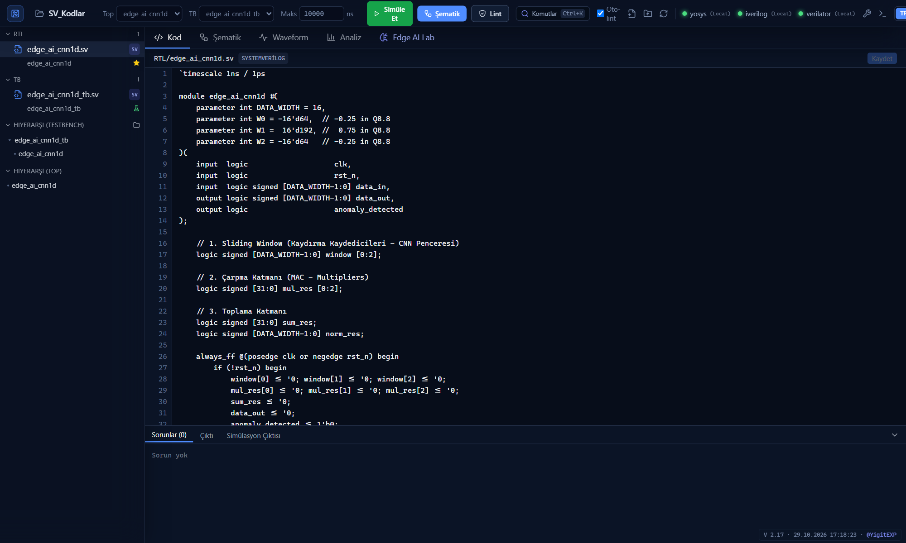
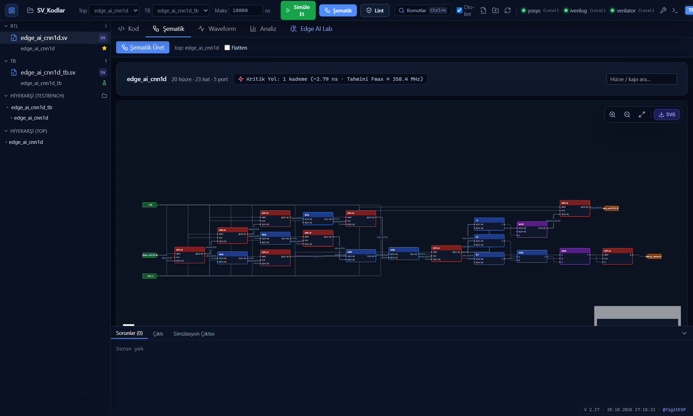
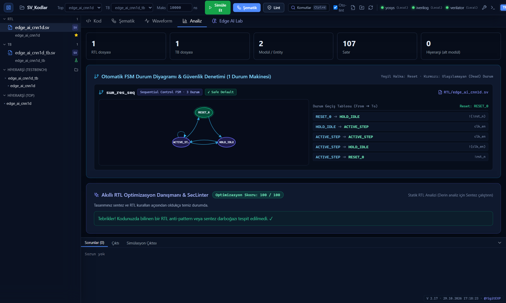
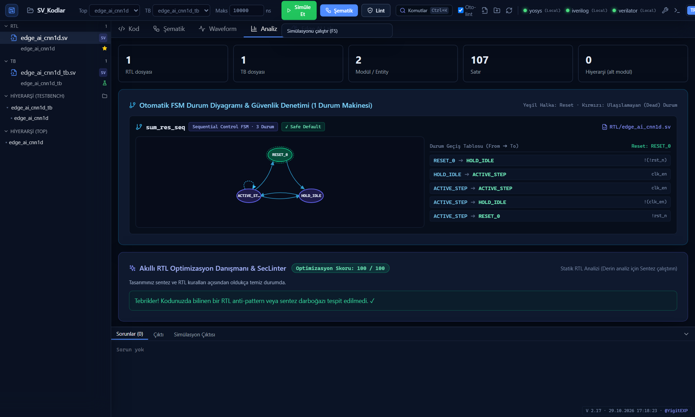
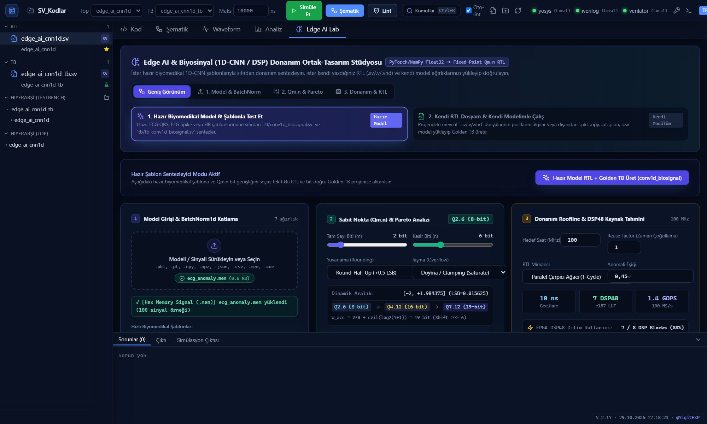
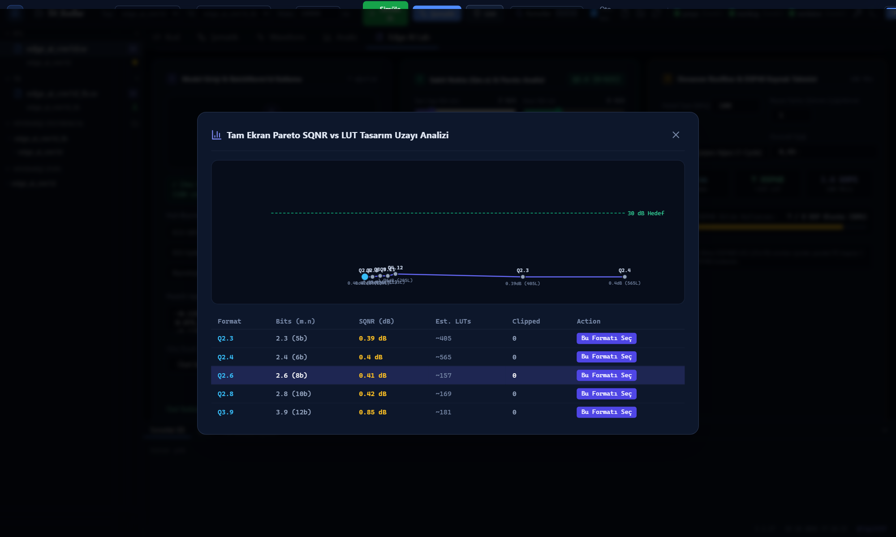
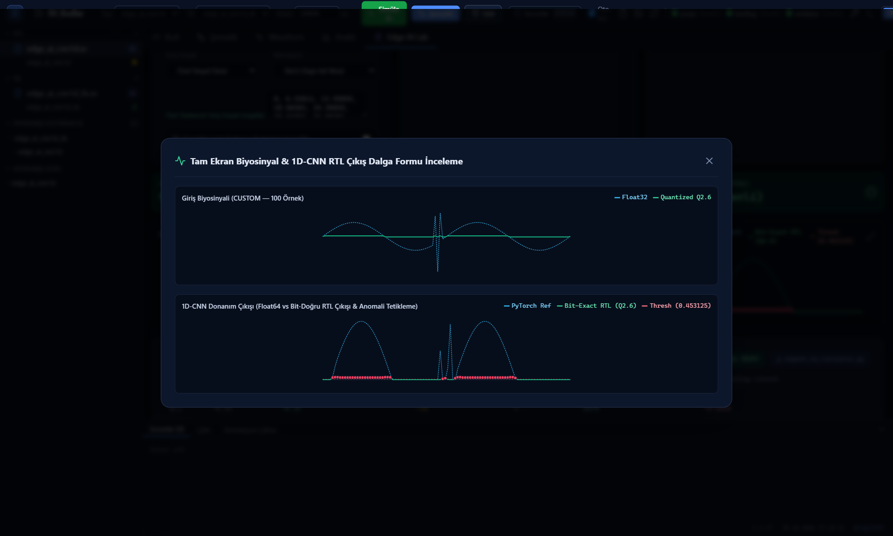
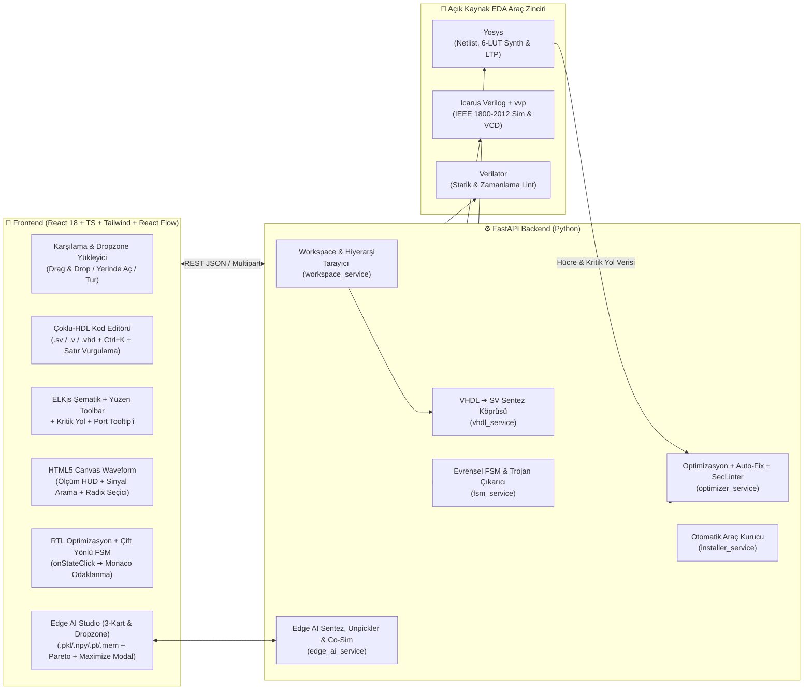

<div align="center">


# CircuitVR (V 2.16)

### **SystemVerilog · Verilog · VHDL RTL, Hardware Security & Edge AI Co-Design Studio**

*Gerçek Zamanlı Sentez Şematiği & Kritik Yol ($F_{\max}$), VCD/Analog Dalga Formu, Tek-Tık Auto-Fix & Donanım Güvenlik Denetçisi (SecLinter), Çift Yönlü FSM Durum Diyagramı ve Python (`.pkl`/`.npy`/`.pt`/`.mem`) ➔ Sabit Noktalı ($Qm.n$) 1D-CNN Biyosinyal Donanım Sentezleyicisi*  
*Real-Time Synthesis Schematics & Critical Path ($F_{\max}$), VCD/Analog Waveform, One-Click Auto-Fix & Hardware Security Linter (SecLinter), Two-Way FSM State Diagram & Python (`.pkl`/`.npy`/`.pt`/`.mem`) ➔ Fixed-Point ($Qm.n$) 1D-CNN Biosignal Hardware Studio*

[](#)
[](#)
[](#)
[](#)
[](#)
[](#)

[**🇹🇷 Türkçe Dokümantasyon**](#-türkçe-dokümantasyon) • [**🇬🇧 English Documentation**](#-english-documentation) • [**📸 Ekran Görüntüleri Galerisi**](#-canlı-arayüz-ve-görsel-tur--visual-showcase) • [**⚡ Hızlı Kurulum**](#-1-hızlı-ve-tam-otomatik-kurulum-sıfır-ayar) • [**🧬 Edge AI Lab**](#-f-edge-ai--biyosinyal-1d-cnn--dsp-donanım-ortak-tasarım-stüdyosu-edge-ai-lab)

</div>

---

## 📸 Canlı Arayüz ve Görsel Tur / Visual Showcase

CircuitVR'ın son sürümüyle (V 2.16) çalışan gerçek bir **1D-CNN Biyosinyal EKG Aritmi Tespiti** projesi (`SV_Kodlar` + `ecg_anomaly.mem`) üzerinden alınmış canlı ekran görüntüleri:

<div align="center">

| 1. Monaco Kod Editörü & RTL Parametreleri | 2. Etkileşimli Şematik & Kapı Detay Tooltip'i |
| :---: | :---: |
| [](samples/01_code_editor_edge_ai.png) | [](samples/02_schematic_interactive_viewer.png) |
| *SystemVerilog canlı doğrulama, MAC parametreleri (`W0, W1, W2`) ve kaydırma penceresi.* | *Yüzen kontrol çubuğu (`Zoom/Fit/SVG`), kapı gecikmeleri ve port bit genişlikleri tooltip'i.* |

| 3. Çift Yönlü FSM & Optimizasyon Analizi | 4. Dalga Formu, Canlı Ölçüm HUD & Sinyal Arama |
| :---: | :---: |
| [](samples/03_fsm_optimization_analysis.png) | [](samples/04_waveform_biosignal_spike.png) |
| *Diyagrama tıklandığında koddaki satıra atlama, tablo hover parlaması ve ölü durum tespiti.* | *Marker A/B zaman farkı ($\Delta t$), MHz frekans HUD göstergesi ve anomali tetikleme sinyali.* |

| 5. Edge AI Lab (Genişletilmiş 3-Kart Görünümü) | 6. Tam Ekran Pareto SQNR vs LUT Tasarım Uzayı |
| :---: | :---: |
| [](samples/05_edge_ai_studio_overview.png) | [](samples/06_pareto_design_space_maximized.png) |
| *Dropzone model yükleyici, BatchNorm katlama, Q8.8 niceleme, DSP48 kullanım barı ve EKG eğrisi.* | *Büyütülebilir SQNR (dB) vs. LUT trade-off eğrisi, 30 dB hedefi ve tek tıkla format seçimi.* |

| 7. Tam Ekran Biyosinyal & Anomali Çıkış İnceleme |
| :---: |
| [](samples/07_biosignal_anomaly_waveform_maximized.png) |
| *Float32 EKG referans sinyali, bit-doğru RTL çıkışı ve 45. milisaniyedeki patolojik aritmi / spike tespiti.* |

</div>

---

# 🇹🇷 Türkçe Dokümantasyon

## 🎯 Proje Neden Geliştirildi?

**CircuitVR**, donanım, FPGA ve Edge AI mühendislerinin devasa boyutlu (50+ GB) kurumsal FPGA/ASIC araçlarını açmadan; **SystemVerilog (`.sv`, `.svh`)**, **Verilog (`.v`, `.vh`)** ve **VHDL (`.vhd`, `.vhdl`)** projelerini saniyeler içinde:
1. **Kodlayabildiği** (canlı hata/uyarı işaretlemeli Monaco editörü, otomatik SHA-1 dosya izleyicisi, **`Ctrl+K` Global Komut Paleti** ve **İnteraktif Tanıtım Turu**),
2. **Sentezleyip Kapı Seviyesi Şematiğini, Kritik Yolu ve Tahmini $F_{\max}$ Değerini İnceleyebildiği** (Yosys + ELKjs ortogonal yerleştirme + **Yüzen Kontrol Çubuğu** + **Akıllı Hücre Port Tooltip'i** + **Kırmızı Kritik Yol Vurgulama** + **Fan-In / Fan-Out Etki Konisi**),
3. **Testbench ile Simüle Edip VCD + Analog Dalga Formunu Analiz Edebildiği** (Icarus Verilog + **Canlı Ölçüm HUD Paneli ($\Delta t$, $\text{MHz}$)**, **Sinyal Arama/Filtreleme Barı**, **Çift Tık Radix Seçici**, **Analog Biyosinyal Çizimi**, **SIGNED 2'ye Tümleyen Radix** ve **`X/Z` Belirsiz Durum Kök-Neden Tablosu**),
4. **Tek Tıkla RTL Auto-Fix, Diff Önizleme ve Donanım Güvenlik Denetiminden (`SecLinter`) Geçirebildiği** (`0–100` Optimizasyon Skoru + **Diff Önizleme Modalı** + **10 Kademeli Geri Al (`Undo`)** + **`// circuitvr-ignore`** + **CDC / Kombinasyonel Döngü / Nadir Tetiklenen Trojan Denetimi**),
5. **Çift Yönlü FSM Durum Diyagramı ile Kodu Birbirine Bağlayabildiği** (SVG durum dairesine veya geçiş okuna tıklandığında Monaco editöründeki ilgili satıra otomatik odaklanan ve parlayan **Two-Way Highlight** motoru),
6. **Edge AI & Biyosinyal (1D-CNN / DSP) Donanım Ortak-Tasarım Stüdyosu (`Edge AI Lab`)** ile Python'da üretilen **`.pkl` / `.pickle` (Güvenli Kısıtlı Unpickler), `.npy`, `.npz`, PyTorch `.pt` / `.pth`, `.json`, `.csv`, `.coe`, `.mem`** modellerini belirgin bir **Dropzone** üzerinden içeri aktarıp; **PyTorch `BatchNorm1d` Katlama (`Fold into Conv1D`)**, **RNE Niceleme**, **Doyma (`Saturate`) vs. Taşma (`Wrap`)**, **Pareto (`SQNR dB vs. LUT`) Grafiği**, **DSP48 Dilim Kullanım İlerleme Çubuğu**, **Tam Ekran (Maximize) Modalları** ve **bit-doğru (bit-exact) ECG/EEG Golden Testbench + RTL hızlandırıcısını** tek tıkla üretebildiği

modern, karanlık temalı (Dark Mode & Glassmorphism) ve **Dual-Runtime (Yerel Tam EDA + Vercel Serverless Bulut)** destekli bir donanım IDEsidir.

---

## 🏗️ Sistem Mimarisi (Architecture)



---

## ⚡ 1. Hızlı ve Tam Otomatik Kurulum (Sıfır Ayar)

GitHub'dan projeyi indiren bir kullanıcının bilgisayarında **Yosys**, **Icarus Verilog** veya **Verilator** kurulu olmasa bile; proje içindeki **Otomatik Araç Kurucu (`setup.bat` / `setup.sh` / `setup_tools.py`)** tüm bağımlılıkları ve taşınabilir (portable) EDA derleyicilerini `~/.circuitvr/tools/` dizinine **yönetici izni veya manuel `PATH` ayarı gerektirmeden** otomatik kurar.

### 🪟 Windows (Tek Tıkla Kurulum ve Başlatma)

```powershell
git clone https://github.com/YigitEXP/CircuitVR.git
cd CircuitVR
setup.bat
```

> **İpucu:** İlk kurulumdan sonra uygulamayı istediğiniz zaman **`run_local.bat`** dosyasına çift tıklayarak başlatabilirsiniz.

### 🐧 Linux & 🍎 macOS

```bash
git clone https://github.com/YigitEXP/CircuitVR.git
cd CircuitVR
chmod +x setup.sh auto.sh
./setup.sh
```

### 🐳 Docker ile Çalıştırma (Opsiyonel)

```bash
docker-compose up --build -d
```

---

## 🔍 2. Temel Modüller ve Tüm İşlevler (V 2.16 DX Envanteri)

### 📂 A) Esnek Proje & Dosya Yönetimi (`rtl/` + `tb/`) + İnteraktif Tur & Komut Paleti
* **Sürükle-Bırak (Drag & Drop) ve Klasör Yükleme:** Proje klasörünüzü veya tekil `.sv`, `.v`, `.vhd`, `.vhdl` dosyalarınızı doğrudan karşılama ekranına sürükleyip bırakabilirsiniz. Dosyalar otomatik olarak `rtl/` (tasarım) ve `tb/` (testbench) gruplarına ayrılır.
* **Yerinde Klasör Açma (In-Place Workspace):** Bilgisayarınızdaki mevcut bir klasörü kopyalamadan doğrudan yerinde açar. Harici bir editörde (ör. VS Code veya Vivado) dosyayı değiştirdiğinizde **SHA-1 parmak izi izleyicisi** değişikliği 2 saniye içinde algılar ve projeyi canlı günceller.
* **Otomatik Hiyerarşi ve Top Modül Tespiti:** Modül ve VHDL `entity`/`architecture` örneklemelerini (`port map` dahil) tarayarak en üst tasarım modülünü (`Top`) ve testbench modülünü (`TB`) otomatik seçer.
* **`Ctrl + K` Global Komut Paleti (`CommandPalette`):** Klavyeden `Ctrl+K` (veya `Cmd+K`) ile tüm aksiyonlara (Simülasyon, Şematik, Lint, Analiz, Edge AI Lab, Dil Değiştirme) ve proje dosyalarına anında bulanık arama (fuzzy search) ile erişim sağlar.
* **Akıllı TopBar Durum Çipleri & Bulut Fallback:** Araçların yerel PATH'te bulunup bulunmadığını `(Yerel)` ve `(Bulut)` rozetleriyle anında gösterir. Araç bulunamadığında Vercel Serverless bulut motoru otomatik olarak devreye girer.

### 📐 B) Yosys Sentez Şematiği, Yüzen Toolbar & Akıllı Hücre Port Tooltip'i (`SchematicViewer`)
* Tasarımınızı Yosys ile gerçek bir kapı/hücre netlist'ine dönüştürür ve **ELKjs** ortogonal yönlendirme algoritmasıyla çizer.
* **Yüzen Cam Kontrol Çubuğu (Floating Toolbar):** Tuvalin sağ üst köşesinde konumlanan cam kontrol çubuğu ile `Zoom In (+)` , `Zoom Out (-)`, `Fit View (Sığdır)` ve `Download SVG (Vektörel Şematik İndir)` eylemleri akıcı biçimde gerçekleştirilir.
* **Akıllı Hücre Bilgi Kartı (Cell Tooltip):** Fareyle herhangi bir mantık kapısının (`$add`, `$mux`, `$dff`, `$pmux`) üzerine gelindiğinde, hücrenin gerçek giriş/çıkış pin genişliklerini (ör. `A [1:0]`, `B [1:0]`, `Y [1:0]`) ve parametrelerini gecikmesiz gösterir.
* **DAG Kritik Yol ve Tahmini $F_{\max}$ Analizi:** Flip-Flop'lar arasındaki en uzun kombinasyonel mantık derinliğini (`logic_depth`) hesaplar, **tahmini maksimum saat frekansını ($F_{\max}$ MHz)** ve darboğaz yolunu gösterir. **🔥 Kritik Yol** butonuyla en yavaş hat kırmızı parıltıyla aydınlatılır.
* **Fan-In / Fan-Out Etki Konisi:** Tıklanan hücreyi süren (**Fan-In**) ve o hücrenin sürdüğü (**Fan-Out**) tüm sinyalleri izole ederek devrenin geri kalanını karartır.

### 📈 C) Simülasyon, Ölçüm HUD Paneli, Sinyal Arama & Radix Menüsü (`WaveformViewer`)
* Testbench dosyanızda `$dumpfile` veya `$dumpvars` yazmayı unutmuş olsanız bile CircuitVR arka planda otomatik bir VCD yakalayıcı (`__cvr_dump.sv`) enjekte eder.
* **Canlı Ölçüm HUD Paneli (Measurement HUD Pill):** Üst kontrol çubuğunda aktif `Marker A` ($t_A$) ve `Marker B` ($t_B$) değerlerini, zaman farkını ($\Delta t$) ve hesaplanan frekansı ($f$ MHz) canlı gösterir.
* **Sinyal Arama & Filtreleme Barı (`🔍 Sinyal Ara...`):** Çok sayıda sinyalin bulunduğu karmaşık tasarımlarda aranan sinyali harf harf filtreleyerek hem isim listesini hem de tuvaldeki dalga çizgilerini senkronize olarak izole eder.
* **Hızlı Radix Değiştirme Menüsü:** Sinyal etiketine çift tıklandığında veya radix rozetine tıklandığında açılan menü ile veri tabanı (`HEX`, `DEC`, `SIGNED`, `BIN`) saniyeler içinde değiştirilir.
* **SIGNED 2'ye Tümleyen & Analog Mod:** Sabit noktalı ($Qm.n$) filtre ve Edge AI çıkışlarını negatif/pozitif işaretli okur ve sürekli analog biyosinyal eğrisi olarak çizer.

### 🛡️ D) Çift Katmanlı Lint ve Yapısal Ön-Denetim (`Verilator` + `AST`)
* Derleyiciye gitmeden önce yapısal analizcimiz eksik `endmodule` / `end entity` hatalarını ve tanımsız modül çağrılarını yakalar.
* Ardından **Verilator** (veya yedek olarak **Icarus Verilog**) ile tam IEEE 1800-2012 lint denetimi çalıştırır.
* Analiz panelindeki herhangi bir hataya tıklandığında editör doğrudan ilgili satıra (`file:line`) odaklanır.

### 🧠 E) Akıllı Optimizasyon Danışmanı, Çift Yönlü FSM & Donanım Güvenliği (`SecLinter` + `FSM`)
* **Çift Yönlü Durum Diyagramı & Editör Bağlantısı (Two-Way Highlight):**
  * FSM SVG diyagramındaki herhangi bir durum dairesine veya geçiş okuna tıklandığında sol taraftaki Monaco kod editörü ilgili durumun koddaki tanımlandığı satıra (`case(state)`, `localparam`, `S_IDLE:`) otomatik kaydırılır.
  * İlgili satır parlak gök mavisi neon ışık efektiyle (`bg-sky-500/25 border-l-2 border-sky-400 animate-pulse`) vurgulanır.
  * Durum Geçiş Tablosundaki bir satırın üzerine gelindiğinde diyagramdaki ok parlar; diyagramdaki okun üzerine gelindiğinde tablodaki satır aydınlanır.
* **Tek Tıkla Auto-Fix, Diff Önizleme & Geri Al (Undo):**
  * Kod değiştirilmeden önce yan yana diff önizlemesi sunulur, 10 kademeli geri alma (`Undo`) geçmişi tutulur ve istenen satırlar `// circuitvr-ignore` direktifiyle bastırılabilir.
* **Donanım Güvenlik Kuralları Envanteri:**

| Kural Kodu | Kategori | Tespit Edilen Anti-Pattern / Güvenlik Riski | Otomatik / Önerilen Donanım Çözümü |
| :--- | :--- | :--- | :--- |
| **`OPT-CASE-UNIQUE`** | **Alan (LUT) & Hız** | `case (state)` kullanımı (Öncelik Zinciri / Priority Tree üretir) | Paralel MUX sentezi için `unique case (state)` (**Auto-Fix**) |
| **`OPT-FSM-ENC`** | **FSM Kodlama** | Genişliği belirtilmemiş `typedef enum` (32-bit FF israfı!) | `typedef enum logic [N:0]` veya One-Hot kodlama (**Auto-Fix**) |
| **`OPT-ALWAYS-LEGACY`** | **Güvenilirlik** | Saatli blokta bloklayan atama (`=`) veya klasik `always @(...)` | `<=` (non-blocking) atama ve `always_ff` / `always_comb` (**Auto-Fix**) |
| **`OPT-LATCH-IF` / `CASE`** | **Latch Koruması** | `if`/`case` bloğunda eksik `else`/`default` veya `$dlatch` hücresi | Tam kapsamlı `default` / `else` dalı (**Auto-Fix**) |
| **`OPT-MUL-POW2`** | **Sıfır Kapı Aritmetiği** | 2'nin kuvvetleriyle çarpma/bölme (`x * 4`, `x / 8`) ve boyutsuz sabitler | Kablo kaydırma (`x << 2`, `x >> 3`) ve `+ 1'b1` (**Auto-Fix**) |
| **`OPT-CDC-UNSYNC`** | **CDC Güvenilirliği** | Farklı saat etki alanları (`clk_a` ➔ `clk_b`) arasında senkronizörsüz sinyal geçişi | 2-kademeli (`2-FF`) senkronizör zinciri (`sync_ff1`, `sync_ff2`) |
| **`OPT-SEC-COMBLOOP`** | **SecLinter (Güvenlik)** | Kombinasyonel blok (`always_comb` / `assign`) içinde sinyalin kendi kendini sürmesi (RO PUF / Osilasyon / DoS riski) | Geri beslemeyi saatli `always_ff` flip-flop üzerinden geçirme |
| **`OPT-SEC-TRIGGER`** | **SecLinter (Trojan)** | `32'hdeadbeef` gibi nadir sihirli sabitlerle yapılan şüpheli karşılaştırmalar | Yalnızca doğrulanmış kontrol durumlarının kullanılması |
| **`OPT-VHDL-STD`** | **VHDL IEEE Standartları** | Standart dışı `std_logic_unsigned`, `clk'event`, sınırsız `integer` | `ieee.numeric_std.all`, `rising_edge(clk)` (**Auto-Fix**) |

### 🧬 F) Edge AI & Biyosinyal (1D-CNN / DSP) Donanım Ortak-Tasarım Stüdyosu (`Edge AI Lab`)
Python'da (`PyTorch` / `NumPy` / `Scikit-Learn`) eğitilen yapay zeka modellerini doğrudan FPGA donanımına taşıyan tam teşekküllü stüdyo:
* **Gelişmiş Dropzone Dosya Yükleyici:**
  * Kesikli kenarlıklı sürükle-bırak Dropzone alanı; `.pkl`, `.pt`, `.npy`, `.npz`, `.json`, `.csv`, `.coe`, `.mem` dosyalarını güvenli unpickler ile anında ayrıştırır ve yüklenen dosyanın adını/boyutunu durum çipi olarak gösterir.
  * **Hex `.mem` Bellek Sinyal Otomatik Ölçekleyici:** 16-bit işaretli Hex bellek dökümlerini (ör. `ecg_anomaly.mem`) Q8.8 formatından float uzayına dönüştürerek 100 örneklik EKG aritmi/anomali sinyali olarak tanır.
* **Genişletilmiş 3-Kart İş İstasyonu Düzeni & Sekme Çubuğu:**
  * Dar sütunlar yerine `[Geniş Görünüm]`, `[1. Model & BatchNorm]`, `[2. Qm.n & Pareto]`, `[3. Donanım & RTL]` pill sekmeleriyle ferah bir çalışma alanı sunar.
  * **1. Model & BatchNorm:** PyTorch BatchNorm1d katlama motoru, hazır biyomedikal şablonlar (ECG QRS, EEG Spike, FIR Denoise) ve Float32 ağırlık girişleri.
  * **2. Sabit Nokta & Pareto:** Tam sayı ($m$) ve kesir ($n$) bit slider'ları, RNE yuvarlama, Saturate/Wrap taşma seçicileri ve Pareto SQNR vs LUT eğrisi.
  * **3. Donanım Roofline & DSP48 Kullanım Barı:** Gecikme ($ns$), GOPS ve FPGA'deki DSP dilimlerinin durumunu gösteren `0 / 8 DSP Blocks` görsel ilerleme çubuğu.
* **Tam Ekran (Maximize) Modalları:**
  * Hem **Pareto Eğrisi** hem de **Biyosinyal & Anomali Çıkış Grafikleri** için sağ üstte büyütme butonu yer alır; tıklandığında yüksek çözünürlüklü modal açılarak tüm veri noktaları ve spike tetikleyicileri derinlemesine incelenebilir.
* **3 Sentezlenebilir RTL Mimarisi:**
  1. `Parallel Pipelined MAC Tree` (II=1 tek çevrimlik paralel çarpıcı ağacı),
  2. `BRAM / LUTROM ($readmemh)` (Ağırlıkları `.mem` veya Vivado `.coe` dosyasından okuyan mimari),
  3. `Folded Time-Multiplexed MAC` (Tek bir DSP48 kullanarak N çevrimde çalışan ultra düşük alanlı FSM).

---

## ⌨️ 3. Klavye Kısayolları

| Kısayol | İşlev |
| :--- | :--- |
| **`Ctrl + K` / `Cmd + K`** | Global Komut Paletini açar (Tüm komutlar ve proje dosyalarında hızlı arama) |
| **`Ctrl + S`** | Açık olan `.sv` / `.v` / `.vhd` dosyasını kaydeder (Oto-lint açıksa anında lint çalıştırır) |
| **`F5`** | Seçili Testbench (`TB`) ile simülasyonu başlatır ve Waveform sekmesini açar |
| **`F6`** | Seçili Top modül (`Top`) için Yosys şematiğini ve Kritik Yol ($F_{\max}$) analizini üretir |
| **`F7`** | Tüm çalışma alanı üzerinde Lint denetimini çalıştırır |

---

## 📁 4. Proje Dizin Yapısı

```text
circuit_vr/
├── api/
│   └── index.py                      # Vercel Python/FastAPI Serverless giriş noktası
├── backend/
│   ├── app/
│   │   ├── api/
│   │   │   └── workspace.py          # REST API uç noktaları (/open, /schematic, /simulate, /lint, /synth-stats, /optimize, /fsm, /edge-ai/*)
│   │   ├── services/
│   │   │   ├── workspace_service.py  # Çoklu-HDL (.sv/.v/.vhd) proje tarayıcı ve hiyerarşi çıkarıcı
│   │   │   ├── yosys_service.py      # Yosys JSON netlist üretici
│   │   │   ├── schematic_service.py  # Yosys netlist ➔ Pin-doğru grafik + DAG Kritik Yol & Tahmini Fmax hesaplayıcı
│   │   │   ├── eda_service.py        # Icarus Verilog, Verilator ve Yosys synth/ltp yöneticisi
│   │   │   ├── vhdl_service.py       # VHDL analizcisi ve sentezlenebilir VHDL ➔ SV köprüsü
│   │   │   ├── optimizer_service.py  # Akıllı RTL Optimizasyon Danışmanı, Auto-Fix, Ignore & SecLinter
│   │   │   ├── fsm_service.py        # SV/Verilog/VHDL Otomatik FSM Çıkarıcı & Dead/Trojan State Dedektörü
│   │   │   ├── edge_ai_service.py    # Edge AI Qm.n Niceleyici, Güvenli Unpickler, BN Katlama, 3 Mimari RTL & Golden TB
│   │   │   ├── installer_service.py  # Çapraz platform otomatik EDA araç kurucusu
│   │   │   └── vcd_parser.py         # Değer değişim (VCD) dalga formu ayrıştırıcısı
│   │   └── main.py                   # FastAPI uygulama girişi ve SPA statik dosya sunucusu
│   ├── tests/
│   │   └── test_v215.py              # Auto-Fix, Ignore, FSM çıkarımı, Kritik Yol Fmax ve Edge AI Golden birim testleri
│   ├── setup_tools.py                # CLI otomatik EDA araç zinciri kurulum betiği
│   └── requirements.txt              # Yerel Python + Yosys bağımlılıkları
├── frontend/
│   ├── public/
│   │   └── favicon.svg               # Özel tasarım silikon çip / devre sekme ikonu
│   ├── src/
│   │   ├── components/               # TopBar, WelcomeScreen, Explorer, CodeEditor, SchematicViewer, WaveformViewer, AnalysisView, EdgeAiView, CommandPalette, OnboardingTour, DeveloperModal
│   │   ├── services/
│   │   │   ├── api.ts                # Backend istemcisi + Bulut yedekleme yönlendiricisi
│   │   │   └── cloudFallback.ts      # Vercel / Tarayıcı içi tam özellikli yedek analiz ve sentez motoru
│   │   ├── i18n.tsx                  # Türkçe (TR) & İngilizce (EN) anlık dil sistemi
│   │   └── version.ts                # Canlı arayüz doğrulama sürüm rozeti (V 2.16)
│   └── index.html
├── samples/                          # Canlı EKG 1D-CNN projesinden alınmış yüksek çözünürlüklü arayüz ekran görüntüleri (01–07)
├── examples/
│   ├── counter_demo/                 # SystemVerilog hiyerarşik sayaç + top_demo örneği
│   └── vhdl_alu_demo/                # VHDL 8-bit ALU + Testbench örneği
├── take_samples.py                   # Otomatik ekran görüntüsü alma betiği (Playwright + Chrome)
├── setup.bat / setup.sh              # Tek tıkla tam otomatik kurulum sihirbazı
├── run_local.bat                     # Hızlı yerel başlatıcı (Windows)
└── vercel.json                       # Vercel dağıtım yapılandırması
```

---

# 🇬🇧 English Documentation

## 🌟 Overview

**CircuitVR (V 2.16)** is a modern dark-mode hardware design, hardware security & Edge AI co-design studio for **SystemVerilog (`.sv`)**, **Verilog (`.v`)**, and **VHDL (`.vhd`)** engineers. It combines:
* **Interactive Yosys Gate-Level Schematics** with orthogonal **ELKjs** routing, **Floating Toolbar** (`Zoom/Fit/SVG Export`), **Cell Port Tooltips** (`A [1:0]`, `B [1:0]`), and **DAG Critical Path & Estimated $F_{\max}$** calculation,
* **Simulation & HTML5 Canvas VCD Waveform Viewer** powered by **Icarus Verilog (`iverilog` + `vvp`)** with **Live Measurement HUD Pill** ($\Delta t$, MHz), **Signal Search & Filter Bar**, **Double-Click Radix Dropdown**, and an **`X/Z` Unknown Root-Cause Inspector**,
* **Two-Way Connected FSM State Diagram & Code Editor**: Clicking on any state node or transition arrow automatically jumps and scrolls Monaco editor to the exact line with an animated glowing pulse highlight,
* **Smart RTL Optimization Advisor & Hardware Security Linter (`SecLinter`)** with **One-Click Auto-Fix**, **Side-by-Side Diff Preview Modal**, **10-Step Undo**, **`// circuitvr-ignore` directives**, and **CDC checks**,
* **Modernized Edge AI & Biosignal (1D-CNN / DSP) Co-Design Studio (`Edge AI Lab`)** featuring a **Drag-and-Drop Dropzone** (`.pkl, .npy, .npz, .pt, .json, .csv, .coe, .mem`), **3-Card Tabbed Layout**, **PyTorch BatchNorm1d Folding**, **RNE rounding & Saturation vs. Wrap-Around overflow**, **DSP48 Slice Usage Progress Bar**, and **Full-Screen Maximize Modals** for both the Pareto Curve and Biosignal Waveforms.

## ⚡ Quick Start (Zero Manual Setup)

Cloning from GitHub automatically provisions Python packages, Node modules, and portable EDA binaries (`yosys`, `iverilog`, `vvp`, `verilator`):

```bash
# Windows
setup.bat

# Linux / macOS
chmod +x setup.sh auto.sh && ./setup.sh
```

---

## 👨‍💻 Geliştirici & Sistem Mimarı / Author & Architect

**Yiğit Can Aktürk (`@YigitEXP`)**  
*Hardware-Software Co-Design · Edge AI on FPGA (1D-CNN Biosignal DSP) · T-Shaped Full Stack & Security by Design*

* **GitHub:** [github.com/YigitEXP](https://github.com/YigitEXP)
* **LinkedIn:** [linkedin.com/in/yiğit-can-aktürk-6b48262b6](https://www.linkedin.com/in/yi%C4%9Fit-can-akt%C3%BCrk-6b48262b6/)
