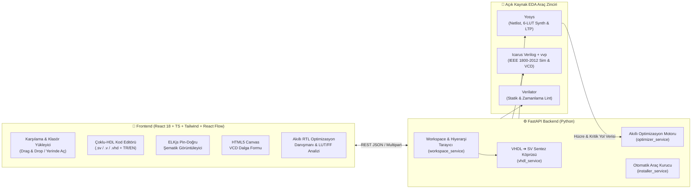

<div align="center">


# CircuitVR

### **SystemVerilog · Verilog · VHDL RTL & Edge AI Hardware Design Studio**

*Gerçek Zamanlı Sentez Şematiği, Dalga Formu (Waveform) Simülasyonu, Statik/Netlist Lint Denetimi ve Akıllı RTL Optimizasyon Danışmanı*  
*Real-Time Synthesis Schematics, VCD Waveform Simulation, Static/Netlist Linting & Smart RTL Optimization Advisor*

[](#)
[](#)
[](#)
[](#)
[](#)

[**🇹🇷 Türkçe Dokümantasyon**](#-türkçe-dokümantasyon) • [**🇬🇧 English Documentation**](#-english-documentation) • [**⚡ Tek Tık Kurulum**](#-1-hızlı-ve-tam-otomatik-kurulum-sıfır-ayar) • [**🚀 Vercel & Bulut Dağıtımı**](#-6-github--vercel-bulut-dağıtımı)

</div>

---

# 🇹🇷 Türkçe Dokümantasyon

## 🎯 Proje Nedir ve Neden Geliştirildi?

**CircuitVR**, donanım ve Edge AI mühendislerinin devasa boyutlu (50+ GB) kurumsal FPGA/ASIC araçlarını açmadan; **SystemVerilog (`.sv`, `.svh`)**, **Verilog (`.v`, `.vh`)** ve **VHDL (`.vhd`, `.vhdl`)** projelerini saniyeler içinde:
1. **Kodlayabildiği** (canlı hata/uyarı işaretlemeli editör ve otomatik dosya izleyici),
2. **Sentezleyip Kapı/Hücre Seviyesi Şematiğini Çizebildiği** (Yosys + ELKjs ortogonal yerleştirme motoru),
3. **Testbench ile Simüle Edip Canlı Dalga Formunu (VCD Waveform) İnceleyebildiği** (Icarus Verilog + HTML5 Canvas Waveform),
4. **Lint ve Yapısal Denetimden Geçirebildiği** (Verilator + Icarus + Akıllı AST Ön-Denetim),
5. **Akıllı RTL Optimizasyon Danışmanı ile Optimize Edebildiği** (`0–100` Optimizasyon Skoru + *"Mevcut Kod ➔ Önerilen Optimize Kod"* dönüşümleri)

modern, karanlık temalı (Dark Mode & Glassmorphism) bir donanım geliştirme ortamıdır (IDE).

---

## 🏗️ Sistem Mimarisi (Architecture)



---

## ⚡ 1. Hızlı ve Tam Otomatik Kurulum (Sıfır Ayar)

GitHub'dan projeyi indiren bir kullanıcının bilgisayarında **Yosys**, **Icarus Verilog** veya **Verilator** kurulu olmasa bile; proje içindeki **Otomatik Araç Kurucu (`setup.bat` / `setup.sh` / `setup_tools.py`)** tüm bağımlılıkları ve taşınabilir (portable) EDA derleyicilerini `~/.circuitvr/tools/` dizinine **yönetici izni veya manuel `PATH` ayarı gerektirmeden** otomatik kurar.

### 🪟 Windows (Tek Tıkla Kurulum ve Başlatma)

```powershell
git clone https://github.com/YigitEXP/circuit_vr.git
cd circuit_vr
setup.bat
```

> **İpucu:** İlk kurulumdan sonra uygulamayı istediğiniz zaman **`run_local.bat`** dosyasına çift tıklayarak başlatabilirsiniz.

### 🐧 Linux & 🍎 macOS

```bash
git clone https://github.com/YigitEXP/circuit_vr.git
cd circuit_vr
chmod +x setup.sh auto.sh
./setup.sh
```

### 🐳 Docker ile Çalıştırma (Opsiyonel)

```bash
docker-compose up --build -d
```

---

## 🔍 2. Temel Modüller ve İşlevleri

### 📂 A) Esnek Proje & Dosya Yönetimi (`rtl/` + `tb/`)
* **Sürükle-Bırak (Drag & Drop) ve Klasör Yükleme:** Proje klasörünüzü veya tekil `.sv`, `.v`, `.vhd`, `.vhdl` dosyalarınızı doğrudan karşılama ekranına sürükleyip bırakabilirsiniz. Dosyalar otomatik olarak `rtl/` (tasarım) ve `tb/` (testbench) gruplarına ayrılır.
* **Yerinde Klasör Açma (In-Place Workspace):** Bilgisayarınızdaki mevcut bir klasörü kopyalamadan doğrudan yerinde açar. Harici bir editörde (ör. VS Code veya Vivado) dosyayı değiştirdiğinizde **SHA-1 parmak izi izleyicisi** değişikliği 2 saniye içinde algılar ve projeyi canlı günceller.
* **Otomatik Hiyerarşi ve Top Modül Tespiti:** Modül ve VHDL `entity`/`architecture` örneklemelerini (`port map` dahil) tarayarak en üst tasarım modülünü (`Top`) ve testbench modülünü (`TB`) otomatik seçer.

### 📐 B) Gerçek Yosys Sentez Şematiği (`SchematicViewer`)
* Tasarımınızı Yosys ile gerçek bir kapı/hücre netlist'ine dönüştürür ve **ELKjs** ortogonal yönlendirme algoritmasıyla çizer.
* **Renk Kodlu Donanım Hücreleri:**
  * 🟦 **Giriş/Çıkış Portları (`port_in` / `port_out`)**
  * 🟪 **Çoklayıcılar (`$mux`, `$pmux`)**
  * 🟩 **Ardışıl / Saatli Elemanlar (`$dff`, `$adff`, `$sdff` Flip-Flop'lar)**
  * 🟨 **Kombinasyonel Aritmetik & Mantık Kapıları (`$add`, `$sub`, `$and`, `$xor`, `$eq`)**
  * 🟧 **Alt Modül Örnekleri (Hiyerarşik bloklar)**
* **Flatten (Düzleştirme) Seçeneği:** Alt modülleri tek tuşla açarak tüm devreyi kapı seviyesinde düzleştirilmiş olarak inceleyebilirsiniz.
* **Net Vurgulama & Arama:** Herhangi bir kabloya (net) veya çok-bitli veri yoluna (`[7:0]`) tıkladığınızda bağlı olduğu tüm kaynak ve hedef pinler parlar.

### 📈 C) Tek Tık Simülasyon ve Canlı Waveform (`WaveformViewer`)
* Testbench dosyanızda `$dumpfile` veya `$dumpvars` yazmayı unutmuş olsanız bile CircuitVR arka planda otomatik bir VCD yakalayıcı (`__cvr_dump.sv`) enjekte eder ve sonsuz döngüleri önlemek için ayarlanabilir maksimum simülasyon süresi (`Maks ns`) uygular.
* **HTML5 Canvas Dalga Formu Görüntüleyici:**
  * Fare tekerleği ile yakınlaştırma/uzaklaştırma (Zoom & Pan),
  * Tıklanan noktaya zaman imleci (Cursor) sabitleme ve her sinyalin o andaki değerini okuma,
  * Çok-bitli veri yollarını **HEX**, **BIN** veya **DEC** tabanında görüntüleme.

### 🛡️ D) Çift Katmanlı Lint ve Yapısal Ön-Denetim (`Verilator` + `AST`)
* Derleyiciye gitmeden önce kendi yapısal analizcimiz eksik `endmodule` / `end entity` hatalarını ve projede bulunmayan alt modül çağrılarını (`MODNOTFOUND`) Türkçe/İngilizce açıklamalarla yakalar.
* Ardından **Verilator** (veya yedek olarak **Icarus Verilog**) ile tam IEEE 1800-2012 lint denetimi çalıştırır.
* Alt paneldeki veya Analiz sekmesindeki herhangi bir hataya tıkladığınızda editör doğrudan ilgili dosya ve satıra (`file:line`) odaklanır.

### 🧠 E) Akıllı RTL Optimizasyon Danışmanı (`optimizer_service.py`)
Analiz sekmesinde kodunuzu hem **Statik AST Örüntü Analizi** hem de **Yosys Sentez Netlist (`stat` + `ltp`)** çıktılarıyla inceleyerek `0–100` arasında bir **Optimizasyon Skoru** verir ve yan yana **"Mevcut Kod ➔ Önerilen Optimize Kod"** kartları sunar:

| Denetim Kategorisi | Tespit Edilen Anti-Pattern / Darboğaz | Önerilen Donanım Çözümü |
| :--- | :--- | :--- |
| **Alan (LUT) & Hız** | `case (state)` kullanımı (Öncelik Zinciri / Priority Tree üretir) | Paralel MUX sentezi için `unique case (state)` |
| **FSM Kodlama** | Genişliği belirtilmemiş `typedef enum` (32-bit FF israfı!) veya Binary vs One-Hot seçimi | `typedef enum logic [1:0]` veya yüksek Fmax için `(* fsm_encoding = "one_hot" *)` |
| **Güvenilirlik & Sentez** | Saatli blokta (`always_ff`) bloklayan atama (`=`) veya klasik `always @(...)` | `<=` (non-blocking) atama ve `always_ff` / `always_comb` |
| **Latch Koruması** | `case` bloğunda eksik `default` / VHDL `when others =>` veya Yosys netlist'inde `$dlatch` hücresi | Tam kapsamlı `default` / `else` dalı |
| **Zamanlama (Fmax)** | Derin `if / else if` ağacı veya 6+ LUT seviyeli uzun kombinasyonel yol (`logic_depth`) | Paralel `unique case (1'b1)` veya ara kademeye Pipeline Register (`always_ff`) |
| **Sıfır Kapı Aritmetiği** | 2'nin kuvvetleriyle çarpma/bölme (`x * 4`, `x / 8`) ve boyutsuz sabitler (`+ 1`) | Kablo kaydırma (`x << 2`, `x >> 3`) ve `+ 1'b1` |
| **VHDL IEEE Standartları** | Standart dışı `std_logic_unsigned`, `clk'event and clk='1'`, sınırsız `integer` (32-bit FF) | `ieee.numeric_std.all`, `rising_edge(clk)`, `integer range 0 to N` |

---

## ⌨️ 3. Klavye Kısayolları

| Kısayol | İşlev |
| :--- | :--- |
| **`Ctrl + S`** | Açık olan `.sv` / `.v` / `.vhd` dosyasını kaydeder (Oto-lint açıksa anında lint çalıştırır) |
| **`F5`** | Seçili Testbench (`TB`) ile simülasyonu başlatır ve Waveform sekmesini açar |
| **`F6`** | Seçili Top modül (`Top`) için Yosys şematiğini üretir |
| **`F7`** | Tüm çalışma alanı üzerinde Lint denetimini çalıştırır |

---

## 📁 4. Proje Dizin Yapısı

```text
circuit_vr/
├── backend/
│   ├── app/
│   │   ├── api/
│   │   │   └── workspace.py          # REST API uç noktaları (/open, /schematic, /simulate, /lint, /synth-stats, /optimize)
│   │   ├── services/
│   │   │   ├── workspace_service.py  # Çoklu-HDL (.sv/.v/.vhd) proje tarayıcı ve hiyerarşi çıkarıcı
│   │   │   ├── yosys_service.py      # Yosys JSON netlist üretici
│   │   │   ├── schematic_service.py  # Yosys netlist ➔ Pin-doğru grafik dönüştürücü
│   │   │   ├── eda_service.py        # Icarus Verilog, Verilator ve Yosys synth/ltp yöneticisi
│   │   │   ├── vhdl_service.py       # VHDL analizcisi ve sentezlenebilir VHDL ➔ SV köprüsü
│   │   │   ├── optimizer_service.py  # Akıllı RTL Optimizasyon Danışmanı (Skor + Önce/Sonra)
│   │   │   ├── installer_service.py  # Çapraz platform otomatik EDA araç kurucusu
│   │   │   └── vcd_parser.py         # Değer değişim (VCD) dalga formu ayrıştırıcısı
│   │   └── main.py                   # FastAPI uygulama girişi ve CORS yapılandırması
│   ├── setup_tools.py                # CLI otomatik EDA araç zinciri kurulum betiği
│   └── requirements.txt              # Python bağımlılıkları
├── frontend/
│   ├── public/
│   │   └── favicon.svg               # Özel tasarım silikon çip / devre sekme ikonu
│   ├── src/
│   │   ├── components/               # TopBar, WelcomeScreen, Explorer, CodeEditor, SchematicViewer, WaveformViewer, AnalysisView
│   │   ├── services/
│   │   │   ├── api.ts                # Backend istemcisi + Bulut yedekleme yönlendiricisi
│   │   │   └── cloudFallback.ts      # Vercel / Tarayıcı içi demo ve analiz motoru
│   │   ├── i18n.tsx                  # Türkçe (TR) & İngilizce (EN) anlık dil sistemi
│   │   └── version.ts                # Canlı arayüz doğrulama sürüm rozeti
│   └── index.html
├── examples/
│   ├── counter_demo/                 # SystemVerilog hiyerarşik sayaç + top_demo örneği
│   └── vhdl_alu_demo/                # VHDL 8-bit ALU + Testbench örneği
├── setup.bat / setup.sh              # Tek tıkla tam otomatik kurulum sihirbazı
├── run_local.bat                     # Hızlı yerel başlatıcı (Windows)
└── vercel.json                       # Vercel sıfır-ayar dağıtım yapılandırması
```

---

## 🚀 5. GitHub & Vercel Bulut Dağıtımı

Proje hem yerel bilgisayarda tam EDA araç zinciriyle hem de **Vercel** üzerinde bulut demo modunda çalışacak şekilde tasarlanmıştır:

1. **GitHub'a Gönderme:**
   ```powershell
   git add .
   git commit -m "feat: CircuitVR multi-HDL IDE with Smart RTL Optimization Advisor"
   git remote add origin https://github.com/YigitEXP/circuit_vr.git
   git push -u origin main
   ```
2. **Vercel'e Bağlama:**
   * [vercel.com/new](https://vercel.com/new) sayfasından GitHub deponuzu seçin ve **Deploy**'a tıklayın.
   * Kök dizindeki [`vercel.json`](vercel.json) sayesinde `frontend/dist` otomatik derlenir ve `cloudFallback.ts` motoru sayesinde ziyaretçileriniz sunucu kurmadan **SystemVerilog Traffic Light**, **Verilog Counter** ve **VHDL 8-Bit ALU** projelerini tarayıcıda deneyimleyebilir.

---

# 🇬🇧 English Documentation

## 🌟 Overview

**CircuitVR** is a lightweight, dark-mode hardware design IDE for **SystemVerilog (`.sv`)**, **Verilog (`.v`)**, and **VHDL (`.vhd`)** engineers. It combines:
* **Real Yosys Gate-Level Schematics** with orthogonal **ELKjs** layout and bus-width inspection,
* **One-Click Simulation & HTML5 Canvas VCD Waveform Viewer** powered by **Icarus Verilog (`iverilog` + `vvp`)**,
* **Fast Static & Timing Linting** powered by **Verilator** and custom structural AST pre-checks,
* **Smart RTL Optimization Advisor** that inspects both your HDL code and synthesized Yosys netlist (`LUTs`, `FFs`, `logic_depth`) to compute a `0–100` Optimization Score with side-by-side **"Current Code ➔ Suggested Optimized Code"** refactoring cards,
* **Instant TR / EN Language Toggle** in the top navigation bar.

## ⚡ Quick Start (Zero Manual Setup)

Cloning from GitHub automatically provisions Python packages, Node modules, and missing EDA binaries (`yosys`, `iverilog`, `vvp`, `verilator`):

```bash
# Windows
setup.bat

# Linux / macOS
chmod +x setup.sh auto.sh && ./setup.sh
```

Once started, open **`http://localhost:3000`** in your browser.

---

## 👨‍💻 Geliştirici & Sistem Mimarı / Author & Architect

**Yiğit Can Aktürk (`@YigitEXP`)**  
*Hardware-Software Co-Design · Edge AI on FPGA (1D-CNN Biosignal DSP) · T-Shaped Full Stack & Security by Design*

* **GitHub:** [github.com/YigitEXP](https://github.com/YigitEXP)
* **LinkedIn:** [linkedin.com/in/yiğit-can-aktürk-6b48262b6](https://www.linkedin.com/in/yi%C4%9Fit-can-akt%C3%BCrk-6b48262b6/)

